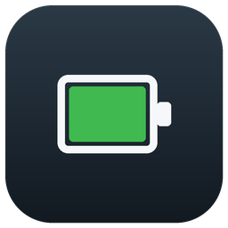
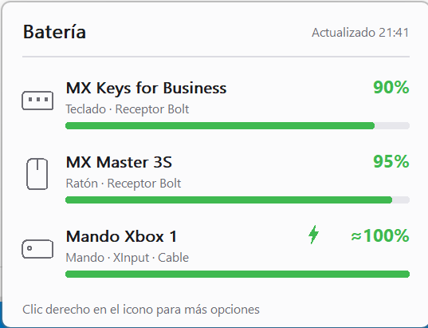

# Batería



Aplicación nativa para Windows que muestra en la bandeja del sistema el estado de la
batería de los dispositivos inalámbricos conectados: teclados, ratones, mandos,
auriculares, etc.



## Características

- **Icono en la bandeja** con el nivel más bajo de todos los dispositivos y código de
  color (verde ≥ 50 %, ámbar ≥ 20 %, rojo < 20 %). Muestra un rayo si algún dispositivo
  está cargando.
- **Tooltip** con el resumen de todos los dispositivos.
- **Panel** (clic izquierdo) con nombre, tipo, transporte, porcentaje, estado de carga y
  barra de nivel.
- **Tiempo restante estimado** a partir del histórico de descarga («quedan 2 d 5 h»).
- **Actualización inmediata** al conectar o desconectar dispositivos, gracias a las
  notificaciones del sistema (`WM_DEVICECHANGE`) y a las notificaciones HID++ de los
  receptores Logitech.
- **Aviso de batería baja** configurable mediante notificación del sistema.
- **Cinco idiomas**: español (por defecto), catalán, inglés, francés y alemán.
- **Diálogo de configuración** (clic derecho → Abrir configuración) para cambiar el idioma,
  el umbral de aviso, el intervalo de actualización, el tiempo restante y los dispositivos
  ignorados, sin editar archivos ni reiniciar.
- Tema claro/oscuro según Windows y soporte de DPI por monitor.
- Un único `.exe` nativo, sin dependencias externas en tiempo de ejecución.
- Sin telemetría ni conexiones de red: todo se lee en local.

## Descargar

Los binarios se publican automáticamente en cada etiqueta de versión:

<https://github.com/angelvisionwin/bateria/releases>

Descarga `bateria.exe` y ejecútalo. No requiere instalación ni dependencias.

Cada release incluye `SHA256SUMS.txt` para comprobar la integridad:

```powershell
Get-FileHash .\bateria.exe -Algorithm SHA256
```

> **Sobre la firma de código:** el binario no está firmado con un certificado de
> confianza pública (es un proyecto personal y no se usa ningún certificado de empresa).
> Windows SmartScreen puede mostrar un aviso la primera vez. Si lo prefieres, puedes
> compilarlo tú mismo desde el código fuente con los pasos de abajo.

## Requisitos

- Windows 10/11 (probado en Windows 11, build 26xxx).
- Rust estable con toolchain MSVC (`x86_64-pc-windows-msvc`).

## Compilar y ejecutar

```powershell
cargo run --release                 # solo el icono en la bandeja
cargo run --release -- --show       # abre también el panel al arrancar
```

El ejecutable se genera en `target\release\bateria.exe`, con el icono y los metadatos
de versión incrustados (requiere el `rc.exe` del Windows SDK, incluido en las Build Tools
de Visual Studio).

El icono se regenera con `python assets/make_icon.py` (necesita Pillow).

## Uso

| Acción | Resultado |
| --- | --- |
| Clic izquierdo en el icono | Abre/cierra el panel |
| Clic derecho en el icono | Menú: Mostrar estado · Actualizar ahora · Iniciar con Windows · Abrir configuración · Salir |
| Clic fuera del panel | Cierra el panel |

Solo puede haber una instancia en ejecución.

### Línea de comandos

| Opción | Descripción |
| --- | --- |
| `--show` | Abre el panel al arrancar |
| `--dump` | Imprime el estado en JSON y termina (útil para informes de errores) |
| `--version` | Muestra la versión |
| `--help` | Muestra la ayuda |

Ejemplo de `--dump`:

```json
[
  {"name":"MX Keys for Business","kind":"keyboard","percent":85,"approx":false,
   "charging":false,"wired":false,"charge":null,"source":"Receptor Bolt",
   "key":"hidpp:c548:2","time_left_seconds":61200}
]
```

- `charging`: el dispositivo **informa** de que está cargando (HID++ o GATT).
- `wired`: el controlador lo ve conectado por cable (solo XInput). No implica carga.
- `charge`: `charging`, `finishing`, `full` o `null`.

## Configuración

La forma más sencilla es el **diálogo de configuración** (clic derecho en el icono →
*Abrir configuración*): los cambios se guardan en el archivo y se aplican al momento,
sin reiniciar. Permite elegir el idioma, el umbral del aviso, el intervalo de
actualización, si se muestra el tiempo restante y qué dispositivos se ignoran (uno por
línea, por nombre o por clave).

La configuración se guarda en `%LOCALAPPDATA%\Bateria\config.toml`, que también se puede
editar con cualquier editor; en ese caso los cambios se aplican al reiniciar.

```toml
# Idioma: auto | es | ca | en | fr | de
language = "auto"

# Aviso de batería baja (porcentaje)
low_battery_threshold = 20

# Intervalo de actualización en segundos (10-3600)
refresh_seconds = 60

# Mostrar tiempo restante estimado
show_time_remaining = true

# Dispositivos a ocultar (nombre o clave)
ignored_devices = []
```

Con `language = "auto"` se usa el idioma de Windows y, si no está soportado, el español.
También se puede abrir la carpeta de configuración desde el menú del icono.

## Cómo obtiene la batería

| Fuente | Dispositivos | Detalle |
| --- | --- | --- |
| **HID++ 2.0** | Logitech mediante receptor Bolt/Unifying | Features `0x1004` (nivel unificado), `0x1001` (voltaje) y `0x1000` (estado), más `0x0005` para el nombre y el tipo. Se sondean los índices 1–8 del receptor y se lee el byte de estado de carga. |
| **GATT** `0x180F` / `0x2A19` | Bluetooth LE conectados | Servicio estándar de batería leído con WinRT. |
| **GATT** `0x2BED` | Bluetooth LE compatibles con BAS 1.1 | *Battery Level Status*: añade el estado de carga (cargando, alimentación externa). |
| **HID** *Generic Device Controls* `0x06` / `0x20` | Teclados y ratones USB que lo expongan | Lectura por *feature report* o *input report*. |
| **XInput** | Mandos tipo Xbox | Nivel aproximado por tramos. Distingue conexión por cable, pero XInput **no informa** de si el mando está cargando, así que el porcentaje se muestra sin rayo. |

## Limitaciones

- El **Bluetooth clásico** (auriculares, móviles) no expone la batería a través de
  las API de Windows, por lo que no aparecen.
- En XInput y en los niveles por voltaje el porcentaje es **aproximado** (se muestra con `≈`).
- Un mando por cable se muestra con la etiqueta «Cable»: no se asume que esté cargando
  porque XInput tampoco lo distingue.
- El tiempo restante necesita al menos una hora de histórico con una caída de un 2 %;
  hasta entonces no se muestra.
- Algunos dispositivos solo publican su nivel cuando están despiertos o conectados.

## Datos en disco

Todo se guarda en `%LOCALAPPDATA%\Bateria`:

| Archivo | Contenido |
| --- | --- |
| `bateria.log` | Registro rotativo con los dispositivos detectados y los errores. |
| `config.toml` | Configuración. |
| `history.tsv` | Muestras de nivel (7 días) para estimar el tiempo restante. |

No se envía nada a la red y no se recopilan datos personales.

## Estructura

```
src/
├─ main.rs              Ventana, bandeja, menú, temporizadores, CLI y notificaciones
├─ meta.rs              Identidad de la aplicación (clases, mutex, rutas, versión)
├─ panel.rs             Panel dibujado con GDI (tema claro/oscuro, barras e iconos)
├─ settings.rs          Diálogo de configuración (idioma, umbral, intervalo, dispositivos)
├─ icon.rs              Icono de batería generado en tiempo de ejecución
├─ i18n.rs              Traducciones (es, ca, en, fr, de)
├─ config.rs            Lectura y escritura de config.toml
├─ history.rs           Histórico y estimación del tiempo restante
├─ util.rs              Log rotativo, idioma del sistema y hora local
├─ platform/            Capa Win32 reutilizable, sin lógica de la aplicación
│  ├─ paths.rs          Rutas del sistema y directorio de datos
│  ├─ registry.rs       Inicio automático y tema claro/oscuro
│  ├─ instance.rs       Instancia única (mutex con nombre)
│  ├─ console.rs        Salida por consola desde un ejecutable gráfico
│  ├─ dpi.rs            Conciencia de DPI del proceso
│  └─ string.rs         Conversión UTF-16
└─ battery/
   ├─ mod.rs            Modelo de datos y agregación de fuentes
   ├─ hidpp.rs          Protocolo Logitech HID++ 2.0 (sesión y notificaciones)
   ├─ hidsys.rs         Enumeración y E/S de dispositivos HID
   ├─ hid.rs            Batería HID estándar (Generic Device Controls)
   ├─ ble.rs            Batería por GATT (Bluetooth LE)
   └─ xinput.rs         Mandos XInput
```

El nombre visible del producto está en `identity.rs` (raíz): lo comparten el
código y `build.rs`, que no depende del crate para no duplicar datos. El resto de
la identidad (nombre del paquete, versión, descripción y licencia) se toma de
`Cargo.toml`.

## Desarrollo

```powershell
cargo fmt --all --check
cargo clippy --all-targets -- -D warnings
cargo test
```

## Integración continua

El flujo de trabajo [`.github/workflows/ci.yml`](.github/workflows/ci.yml) se ejecuta en
cada push y pull request:

1. **Auditoría** de dependencias con `rustsec/audit-check`.
2. **Formato**, **Clippy** (`-D warnings`) y **pruebas**.
3. **Compilación** del `.exe` y publicación como artefacto, junto con `SHA256SUMS.txt`.
4. Al crear una etiqueta `v*`, se genera una release con el binario y su suma de
   verificación adjuntos.

Las *actions* están fijadas por SHA de commit para evitar cambios silenciosos.

```powershell
git tag v0.2.0
git push origin v0.2.0
```

## Licencia

[Mozilla Public License 2.0](LICENSE).
